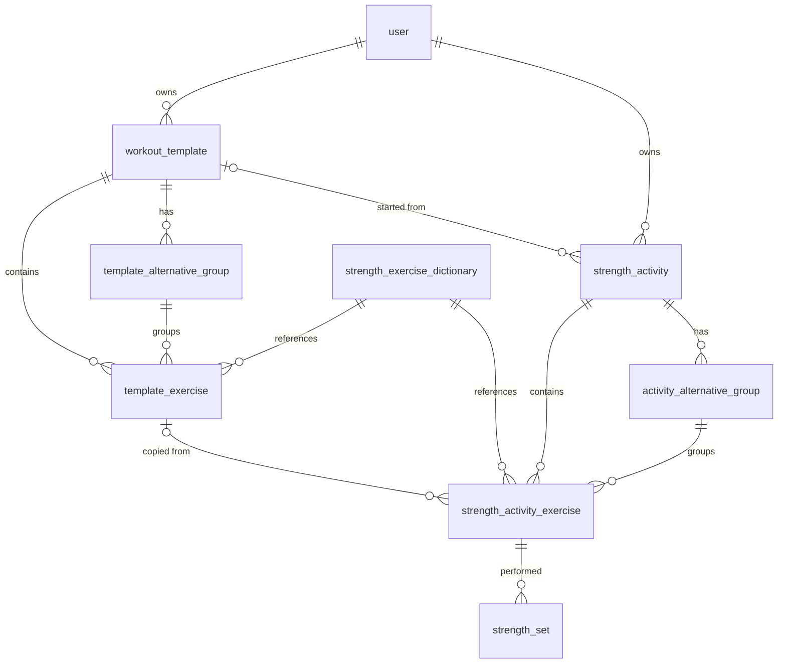

# Template Sessions (Strength)

## Goal

Let a user save a reusable **strength workout template** (exercises, order, prescription, alternatives), start a new workout session from it, and save the finished session as a regular workout in history.

Flow: `Create template → Start session from template → Record sets → Finish → History`

## Key principles

- **Template = plan, activity = snapshot.** Templates hold **planned** values only. Starting a session **copies** the template into `strength_activity` / `strength_activity_exercise` / `strength_set` (including `exerciseId`, prescription and note). Editing or deleting a template never changes past workouts.
- **No template versioning (decided).** The snapshot already keeps what the plan looked like at the time of each session, so editing a template (e.g. changing tempo) is safe without a versions table. Revisit only if we need "show all versions of a template".
- **Everything is per user.** Templates and activities both carry `userId`; every query is scoped to the authenticated user.
- **One active session per user**, enforced by the database (not only by the frontend).

## Data model

New tables live in `libs/api/activities/strength` next to the existing entities and follow the same conventions (string UUID `PrimaryColumn` generated in `@BeforeInsert`, `orderIndex` for ordering, `createdAt` / `updatedAt` as `timestamp` / `Date` everywhere).



### `workout_template`

| Column      | Type               | Notes                          |
| ----------- | ------------------ | ------------------------------ |
| id          | varchar (uuid), PK |                                |
| userId      | varchar, FK → user | Owner. `ON DELETE CASCADE`     |
| name        | varchar            | e.g. `FBW A (dominacja klata)` |
| description | text, nullable     | Optional notes                 |
| createdAt   | timestamp          |                                |
| updatedAt   | timestamp          |                                |

### `template_exercise`

Prescription (previously free text `3×4-6 | 1/0/1/0`) is split into three fields. There are **no planned sets** (`template_set` was dropped) — the template only says *how many* sets, *what reps* and *what tempo*. A target weight, if needed, goes into `note`.

| Column             | Type                                          | Notes                                                    |
| ------------------ | --------------------------------------------- | -------------------------------------------------------- |
| id                 | varchar (uuid), PK                            |                                                          |
| templateId         | varchar, FK → workout_template                | `ON DELETE CASCADE`                                      |
| exerciseId         | varchar, FK → strength_exercise_dictionary    | `ON DELETE RESTRICT` (same as activity)                  |
| alternativeGroupId | varchar, nullable, FK → template_alternative_group | `ON DELETE SET NULL`; see [Alternatives](#alternatives) |
| orderIndex         | int                                           | Position in the **whole template** (flat, one by one)    |
| sets               | int                                           | Prescribed number of working sets, e.g. `3`              |
| reps               | varchar                                       | Prescribed reps, validated by `REPS_PATTERN`, e.g. `4-6` |
| tempo              | varchar, nullable                             | e.g. `1/0/1/0`, validated by `TEMPO_PATTERN`             |
| note               | text, nullable                                | Free text, e.g. target weight, cues                      |
| createdAt          | timestamp                                     |                                                          |
| updatedAt          | timestamp                                     |                                                          |

Removed: `phase`.

### `template_alternative_group`

| Column     | Type                           | Notes                                  |
| ---------- | ------------------------------ | -------------------------------------- |
| id         | varchar (uuid), PK             |                                        |
| templateId | varchar, FK → workout_template | `ON DELETE CASCADE`                    |
| name       | varchar                        | e.g. `Horizontal press`                |
| createdAt  | timestamp                      |                                        |
| updatedAt  | timestamp                      |                                        |

### Alternatives

An **alternative group** is a named set of exercises the user can choose between (e.g. `Horizontal press` = bench press / dumbbell press / machine press). It has only a `name` and its member exercises; each member is a normal `template_exercise` with its own prescription.

Ordering stays **flat**: every exercise has one `orderIndex` in the whole template, and the group has no position of its own. Rules (validated on create/update, `400` otherwise):

- Members of a group occupy **consecutive** `orderIndex` values (no foreign exercise in between).
- A group has at least 2 members; the group's position = the lowest `orderIndex` of its members.
- A group belongs to the same template as its members.

The session keeps the same structure (snapshot): `activity_alternative_group` + `strength_activity_exercise.alternativeGroupId`.

### Changes to existing tables

**`strength_activity`**

| Column     | Type                                     | Notes                                                        |
| ---------- | ---------------------------------------- | ------------------------------------------------------------ |
| userId     | varchar, FK → user                       | Owner. `ON DELETE CASCADE`                                   |
| templateId | varchar, nullable, FK → workout_template | `ON DELETE SET NULL`; origin of the session                  |
| name       | varchar                                  | **Snapshot** of `template.name` (kept if template is renamed/deleted; ad-hoc sessions have no template) |
| status     | enum `strength_activity_status` (`active`, `finished`) | Was varchar                                   |

Removed: `subtitle`.

Plus a **partial unique index** — at most one active session per user:

```ts
@Index('uq_strength_activity_user_active', ['userId'], {
  unique: true,
  where: `"status" = 'active'`,
})
```

**`strength_activity_exercise`** — snapshot of the planned exercise:

| Column             | Type                                           | Notes                                                                                 |
| ------------------ | ---------------------------------------------- | ------------------------------------------------------------------------------------- |
| activityId         | varchar, FK → strength_activity                | Unchanged — identifies the session this row belongs to                                |
| exerciseId         | varchar, FK → strength_exercise_dictionary     | Unchanged — needed for progress ("all bench press sets over time"), ad-hoc exercises and the chosen alternative |
| templateExerciseId | varchar, nullable, FK → template_exercise      | `ON DELETE SET NULL`; informational link only (e.g. "last time on this slot"), never read for display |
| alternativeGroupId | varchar, nullable, FK → activity_alternative_group | `ON DELETE CASCADE`                                                              |
| targetSets         | int, nullable                                  | Copied from `template_exercise.sets` (`sets` is taken by the performed-sets relation) |
| reps               | varchar, nullable                              | Copied from `template_exercise`                                                       |
| tempo              | varchar, nullable                              | Copied from `template_exercise`                                                       |
| note               | text, nullable                                 | Copied from `template_exercise`                                                       |

Removed: `phase`, `details` (client reads `targetSets` / `reps` / `tempo`). Prescription fields are nullable because ad-hoc exercises have no prescription.

**`activity_alternative_group`** (new) — snapshot of `template_alternative_group`:

| Column     | Type                            | Notes               |
| ---------- | ------------------------------- | ------------------- |
| id         | varchar (uuid), PK              |                     |
| activityId | varchar, FK → strength_activity | `ON DELETE CASCADE` |
| name       | varchar                         | Copied              |
| createdAt  | timestamp                       |                     |
| updatedAt  | timestamp                       |                     |

**`strength_set`** — performed values become numbers:

| Column | Type                    | Notes                                                        |
| ------ | ----------------------- | ------------------------------------------------------------ |
| weight | numeric(6,2), nullable  | Was varchar. `numeric`, not float (no `82.4999`, supports 1.25 kg) |
| reps   | int, nullable           | Was varchar. Performed reps are always an exact number       |

Nullable because sets are created empty (`done = false`) at session start. TypeORM returns `numeric` as a string → use a column transformer to map it to `number` (`numericColumnTransformer` in `strength-set.entity.ts`).

**Existing data:** development only — no migration/backfill. Run `npm run db:reset:strength` (seed with `--reset`: drops strength + template tables (incl. the old `template_set`) and the `strength_activity_status` enum type, re-synchronizes, seeds). `npm run db:seed:strength` re-seeds without dropping. The seed:

- creates (or reuses by email) a dev user `dev@traininglog.local` / `dev` and sets `userId` on every seeded `strength_activity`,
- fills `targetSets` / `reps` / `tempo` / `note` / `templateExerciseId` on seeded `strength_activity_exercise` rows and numeric `weight` / `reps` on sets (some left empty),
- keeps at most one `active` activity per user (other active ones of the dev user are finished),
- inserts a sample `workout_template` `FBW A (dominacja klata)` with 4 slots (5 `template_exercise` rows): the first slot is the alternative group `Horizontal press` with 2 members (barbell / dumbbell bench press).

## Validation

Shared constants (in `strength.types.ts`, reusable by the client):

```ts
// "5", "4-6", "ALL", "~"
export const REPS_PATTERN = /^(?:\d{1,3}(?:-\d{1,3})?|ALL|~)$/;
```

- `5` — exact reps
- `4-6` — range; additionally check `min <= max` (regex can't do that)
- `ALL` / `~` — as many as possible / not fixed

Applied to `template_exercise.reps` (prescription only — performed `strength_set.reps` is an int). Invalid value → `400 Bad Request`.

Tempo (optional field, validated when present):

```ts
// eccentric / pause / concentric / pause, "X" = explosive: "1/0/1/0", "3/1/X/0"
export const TEMPO_PATTERN = /^[0-9X](?:\/[0-9X]){3}$/;
```

Performed sets (`validateSetsUpdate`): `weight >= 0` (max 2 decimals, ≤ `9999.99`), `reps` integer `>= 0`, both nullable, `done` boolean. Numeric strings (`"60"`, `"82,5"`) and `""` are accepted and normalized, so older clients keep working during the transition. Invalid value → `400`.

Alternative groups: rules from [Alternatives](#alternatives). Additionally: `clientKey`s are unique, every `alternativeGroupKey` references one of them, ids are not duplicated, `POST` payloads carry no ids and `PUT` ids must belong to the edited template (`400` otherwise).

## API

Template endpoints live in `WorkoutTemplateController` (`@Controller('activities/strength/templates')`), the rest in `StrengthController` (`@Controller('activities/strength')`). Both are protected by `AuthGuard`; `userId` comes from the JWT `sub` via `@CurrentUserId()`, never from the payload.

`AuthGuard` and `@CurrentUserId()` live in the shared lib `libs/api/auth` (import alias `api-auth`), so API libs can use them; `apps/api/.../auth.guard.ts` re-exports it.

| Method | Path                          | Description                                                      |
| ------ | ----------------------------- | ---------------------------------------------------------------- |
| GET    | `templates`                   | List user's templates (summary with exercise count)              |
| GET    | `templates/:templateId`       | Template with exercises, prescription and alternative groups     |
| POST   | `templates`                   | Create template (exercises + groups in one payload)              |
| PUT    | `templates/:templateId`       | Full replace of name/description/exercises/groups                |
| DELETE | `templates/:templateId`       | Delete template; past activities keep data, `templateId` → null  |
| POST   | `templates/:templateId/start` | Create new active `strength_activity` from template              |
| POST   | `:activityId/finish`          | `status = 'finished'`, `finishedAt = now()` (save workout)       |

`PUT` runs in a transaction and **upserts by `id`**: items with an `id` belonging to this template are updated, items without `id` are inserted, existing rows missing from the payload are deleted. (Delete-and-reinsert would change ids and break `strength_activity_exercise.templateExerciseId`.) Same for groups. Accessing another user's template/activity returns `404`.

### DTOs (`strength.types.ts`)

```ts
export interface TemplateExerciseDto {
  id: string;
  exerciseId: string;
  title: string;       // from dictionary
  description: string; // from dictionary
  alternativeGroupId: string | null;
  sets: number;
  reps: string;
  tempo: string | null;
  note: string | null;
}

export interface AlternativeGroupDto {
  id: string;
  name: string;
}

export interface WorkoutTemplateDto {
  id: string;
  name: string;
  description: string | null;
  items: TemplateExerciseDto[];            // ordered by orderIndex
  alternativeGroups: AlternativeGroupDto[];
}

export interface WorkoutTemplateSummaryDto {
  id: string;
  name: string;
  description: string | null;
  exerciseCount: number;
  updatedAt: string;
}

export interface WorkoutTemplateUpsertDto {
  name: string;
  description?: string | null;
  alternativeGroups: {
    id?: string;      // existing group (PUT)
    clientKey: string; // referenced by items in the same payload
    name: string;
  }[];
  items: {
    id?: string;      // existing template_exercise (PUT)
    exerciseId: string;
    alternativeGroupKey?: string | null; // = alternativeGroups[].clientKey
    sets: number;
    reps: string;
    tempo?: string | null;
    note?: string | null;
  }[];
}
```

Order of `items` in the payload defines `orderIndex`. `clientKey` lets a new group and its new members be created in one request. `alternativeGroups` in responses are ordered by position (lowest `orderIndex` of their members).

`StrengthExerciseDto` (session) gets `targetSets`, `reps`, `tempo`, `note`, `alternativeGroupId` and drops `details` / `phase` (`sets` is already the performed sets array). `StrengthSetDto.weight` / `reps` become `number | null`. `StrengthActivityDto` gets `alternativeGroups: AlternativeGroupDto[]` and drops `subtitle`.

## Start session from template

`POST templates/:templateId/start` — one DB transaction:

1. Load template with exercises (ordered) and alternative groups for the current user; `404` if missing.
2. Check for an active activity of the user → `409 Conflict` (`Active strength activity already exists`).
3. Insert `strength_activity`: `userId`, `name = template.name`, `status = 'active'`, `startedAt = now()`, `templateId`.
4. For each `template_alternative_group` insert `activity_alternative_group` (copy `name`), keep a map template group id → activity group id.
5. For each `template_exercise` insert `strength_activity_exercise` with same `exerciseId`, `orderIndex`, `targetSets = sets`, `reps`, `tempo`, `note`, `templateExerciseId`, mapped `alternativeGroupId`.
6. For each exercise insert `targetSets` empty `strength_set` rows: `done = false`, `weight = null`, `reps = null`, `orderIndex = 0..n-1`.
7. Return `StrengthActivityDto` (same shape as `GET active`).

**Alternatives during the session:** all members of a group are copied; the user logs sets on the one they actually do. On `finish`, in each group, members with **no done sets** are deleted if at least one other member of the group has done sets (the history keeps only the chosen exercise; if nothing was done, the group stays as is). `finish` runs in one transaction (`findUnusedAlternatives` → delete → status update).

**Active session guarantee (decided):**

- Frontend blocks starting a second session (UX).
- Step 2 is the friendly backend check → `409`.
- The partial unique index `uq_strength_activity_user_active` is the real guarantee. If two requests race, the second insert fails with Postgres `23505` → mapped to the same `409`.
- No separate cache — the index *is* the persisted "user has an active session" flag, and `GET active` is a cheap indexed lookup. If a cache (e.g. Redis) is added later, the DB stays the source of truth.

During the session the existing `PUT exercises/:exerciseId/sets` works (numeric `weight` / `reps`; must also verify the exercise belongs to the user's activity). `finish` stores the session as a completed workout in history and frees the slot for a new active session.

## Implementation checklist

Done (first iteration):

- [x] Entities: `WorkoutTemplate`, `TemplateExercise`, `TemplateSet` in `src/lib/entities/`
- [x] `StrengthActivity`: `userId`, `templateId`, partial unique index
- [x] `StrengthActivityExercise`: `targetSets`, `reps`, `tempo`
- [x] Inverse relation `templateExercises` on `StrengthExerciseDictionary`
- [x] Register entities in `StrengthModule` (`forFeature`) **and** in `apps/api/src/app/app.module.ts` `entities`
- [x] Export new entities/types/`REPS_PATTERN`/`TEMPO_PATTERN` from `src/index.ts`
- [x] Validation of reps (+ range order) and tempo
- [x] Service: template CRUD, `startFromTemplate`, `finishActivity` (`DataSource.transaction`), map `23505` → `409`
- [x] Scope existing endpoints (`GET`, `GET active`, `PUT sets`) by `userId`
- [x] Controller endpoints + `AuthGuard` (shared `api-auth` lib, `@CurrentUserId()`)
- [x] Remove hard-coded `getTemplateActivity()` mock
- [x] Seed: dev user, `userId` on activities, prescription fields, max one active per user, sample template; reset dev DB
- [x] Tests (`strength.service.spec.ts`, `workout-template.service.spec.ts`, `strength.validation.spec.ts`)

Model rework (this revision):

- [x] Drop `TemplateSet` entity, `plannedSets` from DTOs; start creates `targetSets` empty `strength_set` rows
- [x] `TemplateExercise`: remove `phase`, add `note`, `alternativeGroupId`
- [x] New entities `TemplateAlternativeGroup`, `ActivityAlternativeGroup` (register in module + `app.module.ts`, export)
- [x] `StrengthActivityExercise`: remove `phase`, `details`; add `note`, `templateExerciseId` (`SET NULL`), `alternativeGroupId`
- [x] `StrengthActivity`: remove `subtitle`, `status` → enum
- [x] `StrengthSet`: `weight` → `numeric(6,2)` nullable (+ transformer), `reps` → `int` nullable
- [x] Consistent `timestamp` / `Date` for `createdAt` / `updatedAt` / `startedAt` / `finishedAt`
- [x] `PUT templates/:id`: upsert by `id` instead of delete-and-reinsert
- [x] Alternative group validation (consecutive `orderIndex`, ≥ 2 members, same template)
- [x] `finish`: remove unused alternatives
- [x] Update DTOs + seed (sample alternative group)
- [x] Tests: snapshot unaffected by template edit (incl. tempo/note), `PUT` keeps ids, group validation cases, alternatives cleanup on finish, numeric set validation
- [ ] Reset dev DB (`npm run db:reset:strength`) and run `nx test strength-service` locally
- [ ] Client: send `Authorization: Bearer` header (interceptor), template list, template editor (incl. alternatives), "Start" action, numeric set inputs
  - Client types in `libs/client/activities/strength/data-access/src/lib/strength.types.ts` still use `subtitle`, `phase`, `details` and string `weight` / `reps` — they no longer match the API and must be updated together with the components that read them.

## Out of scope (later)

- Prefill set values from the **last performed** session of the same template (replacement for planned weights).
- Template versioning (not needed thanks to snapshots — see Key principles).
- Supersets / circuits (different grouping type than alternatives).
- User-defined exercises in the dictionary (`userId` nullable) and soft delete / archive of templates.
- "Save finished workout as template".
- Template sharing / duplication.
- Real migrations instead of `synchronize: true`.
- JWT lifetime is `600s` (`AuthModule`) — needs a longer expiry or refresh tokens before the client uses the protected endpoints for a whole workout.
